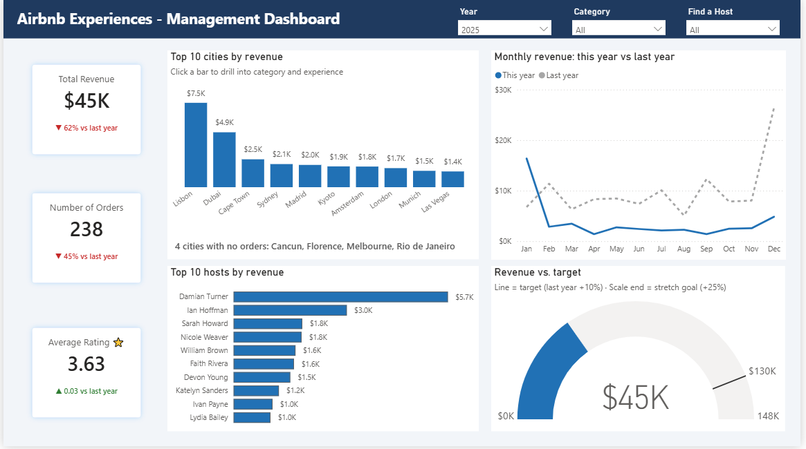
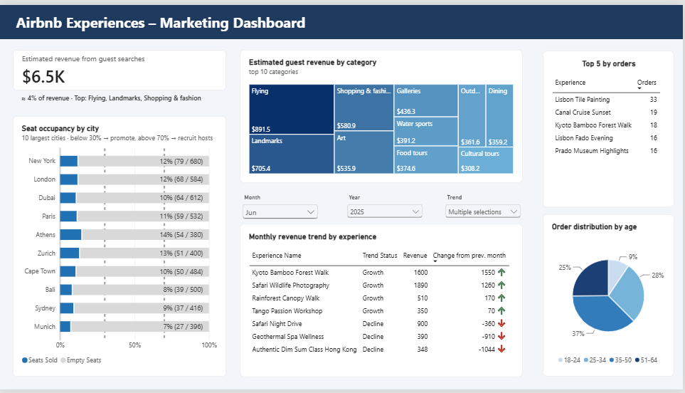
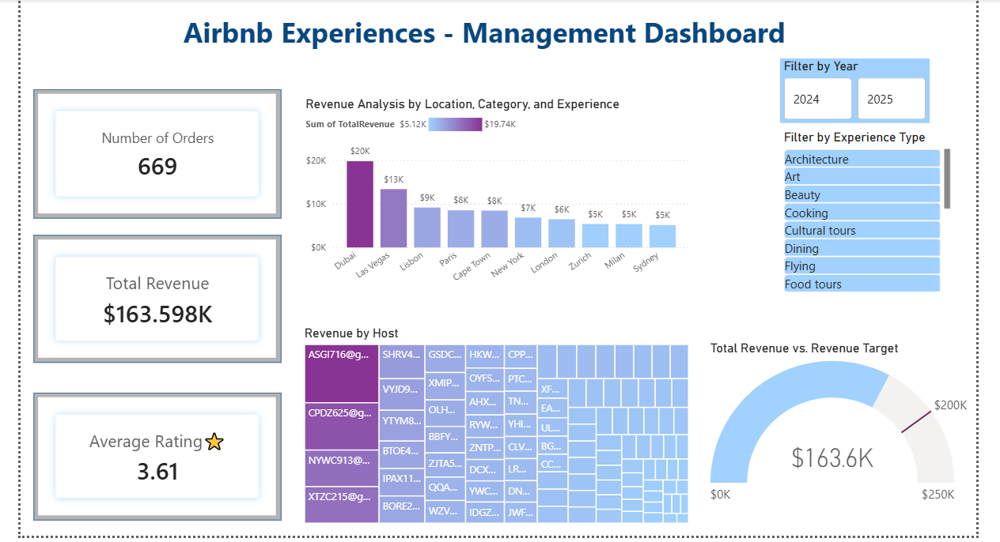
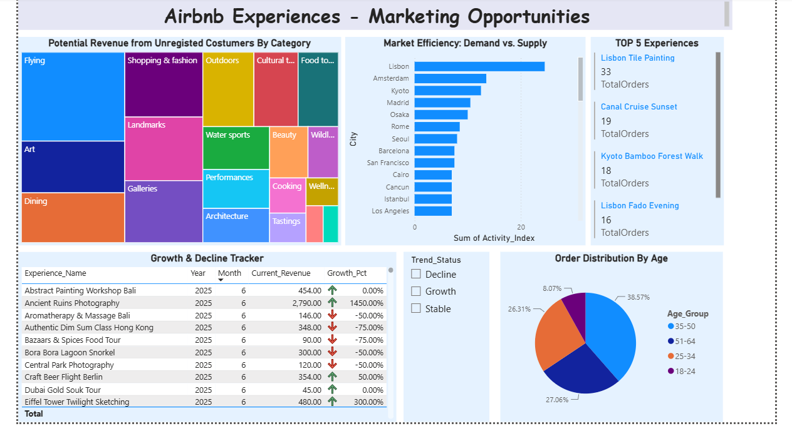

# Airbnb Experiences – Marketing & Management Analytics

SQL and Power BI analysis of an Airbnb Experiences–style marketplace: hosts offer tours and workshops, guests search and book them.
Built on a relational database from a team project in the Databases course (Industrial Engineering & Management, Ben-Gurion University), then reworked by me into two dashboards.

## Business questions

**Management dashboard** (filters for the whole page: year, category, host)
- How are we doing? Revenue, orders and average rating, each compared with last year
- Are we on target? Revenue against a target of last year + 10%, which follows any filter
- When did things change? Monthly revenue, this year against last year
- Where does revenue come from? Top 10 cities (drill down to category and experience) and top 10 hosts

**Marketing dashboard**
- How much revenue is lost to guests who search but never sign up? Estimated by category
- Where is supply higher than demand? Seat occupancy for the 10 largest cities, with action thresholds
- Which experiences grew or declined last month? Only experiences that can be compared with the previous month
- Which experiences sell best, and who books (age groups)?

## Key findings

- Revenue fell **62%** in 2025 compared with 2024. The monthly chart shows a peak in December–January and a sharp drop from February, so the decline is not seasonal.
- Under **15%** of seats were sold in each of the 10 largest cities: the main problem is demand, not supply.
- Guests who searched without signing up represent an estimated **~4%** of revenue, mostly in Flying, Landmarks and Shopping & fashion.
- 4 cities had no orders at all in 2025.

## What I fixed in the original SQL

| Problem | Effect | Fix |
|---|---|---|
| Joining orders and reviews in one query | Each order counted once per review, inflating totals | Aggregate each table separately before joining |
| Month-over-month comparison with `LAG` | Compared to the last month that had orders, even months apart | Compare only to the month directly before; label the rest "New" / "Back after a break" |
| Age and "recent" filters based on `GETDATE()` | Results change every day the query runs | Measure from the last date in the data |
| Quartiles (`NTILE`) to label cities | One order could move a city to a different group | Fixed business thresholds (below 30% / above 70% occupancy) |
| Revenue target typed into the chart | Same target for one year, two years or one host | DAX measure: last year's revenue + 10% for whatever is filtered |

## Data model

The management dashboard uses a star schema: orders and reviews are fact tables, connected to a calendar table and an experiences table (category, city, host). That way a host or category filter applies to revenue and to ratings at the same time.

## Repository

| Folder | Contents |
|---|---|
| `sql_server/` | SQL Server scripts: the original queries with explanations, the fixes, and the views behind each dashboard |
| `dashboards/` | Power BI files and screenshots (before and after) |

## Notes

- Team project of three students. I built the original marketing dashboard; afterwards I reviewed and fixed the SQL, rebuilt the marketing dashboard and rebuilt the management dashboard on a new data model.
- The data is synthetic course data.
- Comments in the SQL Server scripts are in Hebrew.

**Tools:** SQL Server, Power BI (DAX)

## Before and after

| Before | After |
|---|---|
|  |  |
|  |  |
